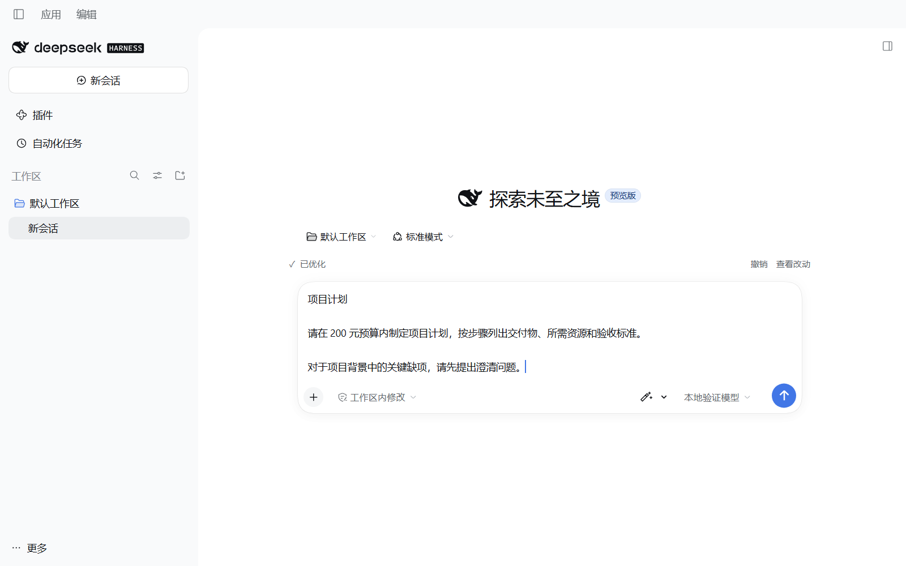
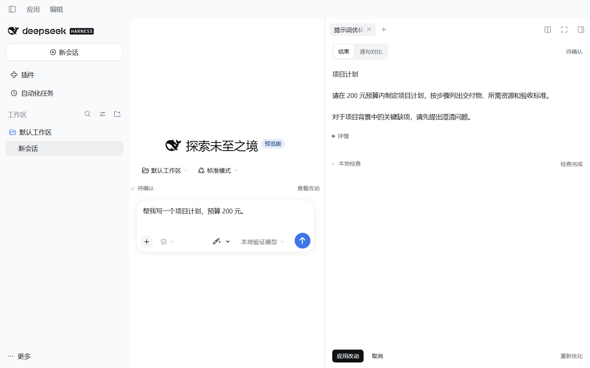

# 增强提示词 0.4.1 · DeepSeek Harness

点击输入框中的魔法棒，即可使用当前模型优化提示词并写回。完成后可撤销；只有需要仔细检查时才打开侧栏。

精确适配 DeepSeek Harness 0.2.1-rc.2，支持桌面 Electron 与 Web，复用已有模型配置。



## 桌面安装与升级

从 [v0.4.1 Release](https://github.com/gu040303-ai/dsh-prompt-enhancer/releases/tag/v0.4.1) 下载 [dsh-prompt-enhancer-0.4.1.tgz](https://github.com/gu040303-ai/dsh-prompt-enhancer/releases/download/v0.4.1/dsh-prompt-enhancer-0.4.1.tgz)。请选择预构建的 tgz 安装包；GitHub 自动生成的 Source code ZIP 是开发源码。Release 同时提供 SHA256SUMS-0.4.1.txt，可核对文件完整性。

1. 打开左侧「插件」。如果已安装旧版 dsh-prompt-enhancer，进入详情并卸载。
2. 点击「添加插件」，在「包名或地址」粘贴本地 dsh-prompt-enhancer-0.4.1.tgz 的绝对路径。
3. 点击「安装」，完成后「立即启用」。
4. 完整退出 Harness 并重新打开，刷新宿主静态资源。

通过桌面原生管理器安装；不要用 CLI 管理 desktop profile。安装包包含构建产物，不需要安装源码 ZIP 或运行构建脚本。

Web 安装到已有 profile：

```powershell
dsh plugin --profile web add "./dsh-prompt-enhancer-0.4.1.tgz"
# 卸载
dsh plugin --profile web remove dsh-prompt-enhancer
```

## 日常使用

写草稿 → 点击魔法棒 → 完成后写回。原来「打开面板 → 优化草稿 → 应用」的三次点击，普通路径现在只需一次。请求过程中保持原文，下面提供「取消」；完成后显示「已优化并写回」以及撤销、查看改动和关闭入口，窄窗口自动换行，不自动展开侧栏，也不自动发送消息。

魔法棒旁的下拉菜单保留详细功能：

| 入口 | 行为 |
| --- | --- |
| 先预览再应用 | 直接开始生成并打开侧栏，预览不写回 |
| 按检查结果优化 | 本地检查并由 Host 重新核验后改写，正常完成后写回 |
| 查看本地检查 | 只展开五类检查，不调用模型 |



侧栏默认显示干净的「结果」，点击「逐句对比」才显示句级勾选；取消勾选保留对应原句，点击底部「应用改动」一次写回。检查、耗时和硬事实统计按需展开；「重新优化」产生新预览，不立即覆盖当前文字。暗色与窄窗口使用同一原生侧栏，底部操作保持可见。

原生 Ctrl+Z／⌘+Z 可以撤销整次写回。「查看改动」中也可恢复原文。后续编辑会使旧结果的替换操作失效。

## 纯文本输出

模型指令明确要求自然段、普通编号及「目标：」这样的文本标题，不生成 Markdown 展示格式。Host 与客户端还会清理模型未遵守要求时的常见格式：

- 去除标题井号、加粗／斜体／删除线标记、引用、项目符号与复选框外壳。
- 表格改为保留列名与值的普通文本；链接保留文字和完整网址。
- 去除全文或代码片段的围栏、行内反引号包装，保留实际代码、运算符、路径与网址。
- 「补回细节」也使用纯文本，不再新加反引号或围栏。

例如模型返回「# 项目目标」与「**预算 200 元**」，写入后为「项目目标」与「预算 200 元」。原文代码中的 a ** b、# comment、带下划线的路径等字面内容会受保护；撤销恢复用户原始输入。要求最终交付 Markdown、JSON 等的任务约束仍然保留，改变的是提示词本身的展示格式。

## 检查与草稿保护

五类检查为工具、路径、技能／子代理、审批策略、交付物，保留 ok／warn／unknown 三态。未核实不会变成“不存在”或“无权限”；可选交付物提示不成为强制要求。每类检查最多 500ms，整体最多 1500ms，客户端传输上限 1800ms。

仅显式选择「按检查结果优化」才使用经 Host 重新核验的警告。工作区外不探测，不跟随符号链接或目录联接，不创建子代理。普通快捷优化不擅自把检查结论加入改写要求。

快捷结果若检测到原始代码、路径、网址、@提及或部分数字丢失，会保留原文并转入预览；确认或补回后才能应用。这是有限的逐字检查，不保证语义完全保真。

编辑、发送、切换会话、取消或卸载会使请求取消／失效；关闭侧栏只取消预览请求，不取消独立的快捷请求。使用原生 draftRev 做最终校验，写回为一次编辑事务。失败、空输出、截断及超时均保留原文。

支持普通文本与带附件文本；行内引用卡片、斜杠命令及被寻址子代理会话暂不启用优化。任意区间采纳未包含在本版本中。

## 动效与样式

沿用宿主字体、颜色和菜单。状态反馈轻淡入，写回区域短暂轻亮，加载使用小型转圈；不会用逐字动画拖延写回。减少动态效果设置生效时关闭这些动效。差异文字使用正常明暗主题正文色，仅配浅色底纹和增删符号，避免大段低对比度红绿文字。

## 模型、数据与配置

复用当前会话的 modelDirectories → Remote Gateway → ctx.llm.prepareCall()，不另外处理 API Key。不带聊天历史、不提交用户消息、不启动代理回合、不执行工具。草稿与编辑指令会发送给当前模型，调用前写入 ignorable 的 plugin:prompt-enhancer/request 审计记录；卸载不删除已有审计记录。

默认配置在 cordis.patch.yml：timeoutMs 60000、maxInputBytes 65536、maxOutputTokens 4096、maxConcurrentRequests 2。它们不修改正常聊天配置；如完全覆盖，请提供全部四项。

## 源码与验证

Node 要求 ^22.19.0 或 >=24.0.0。

```powershell
npm ci --ignore-scripts
npm run check
```

另有原生组件与 Lexical 浏览器检查、真实 Web／Electron 检查及安装卸载验证。所有模型验证使用隔离本地适配器，没有外部付费模型调用。证据与边界见 [VALIDATION.md](VALIDATION.md)，实现对应见 [CLAIMS.md](CLAIMS.md)，版本变化见 [CHANGELOG.md](CHANGELOG.md)。

浏览器夹具需要官方 dsh-v0.2.1-rc.2 源码与显式浏览器路径：

```powershell
$env:HARNESS_SOURCE = "D:/path/to/deepseek-harness-rc2"
$env:DSH_TEST_BROWSER_PATH = "C:/Program Files/Google/Chrome/Application/chrome.exe"
$env:DSH_ENHANCER_WORK = "D:/isolated-test/evidence"
npm run test:browser
```

完整应用脚本为 scripts/test-installed.mjs。Web 设置独立实例 DSH_TEST_URL；加载 tests/local-model.patch.yml 及宿主 pin-browse-picker.overlay.yml。桌面使用独立 home、浏览器目录、仅监听 loopback 的调试端口，设置 DSH_TEST_DESKTOP_PORT、DSH_TEST_DESKTOP_MAIN_PORT、DSH_TEST_DESKTOP_HOME。不要把账号或调试 URL 中的 token 放入证据。测试脚本和模型不进入安装包。

适配参考：[官方 rc.2 源码](https://github.com/deepseek-ai/deepseek-harness/tree/dsh-v0.2.1-rc.2)，提交 687f282e8625c6b8d11ff58211a90524be2e4317。未修改宿主源码。MIT License。
